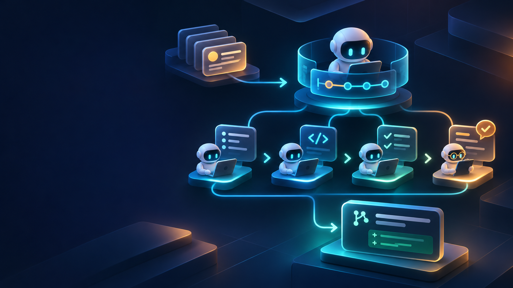
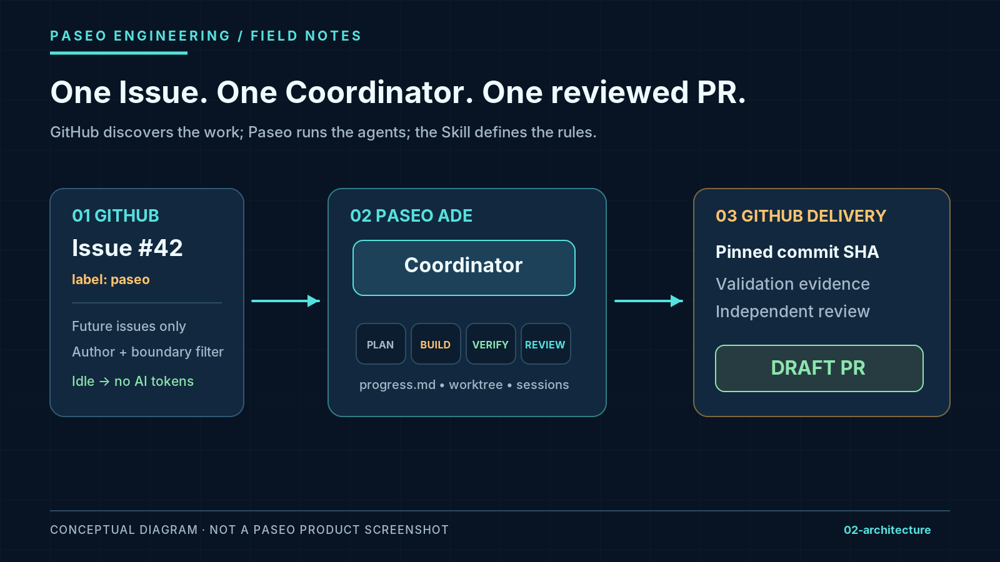
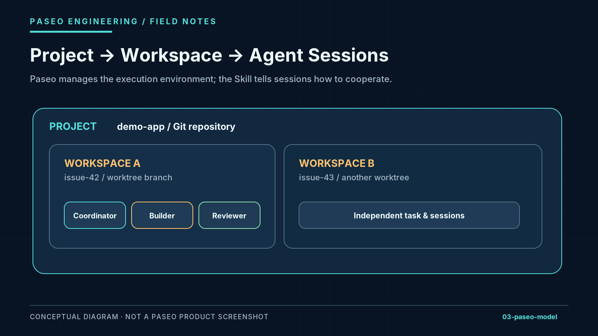
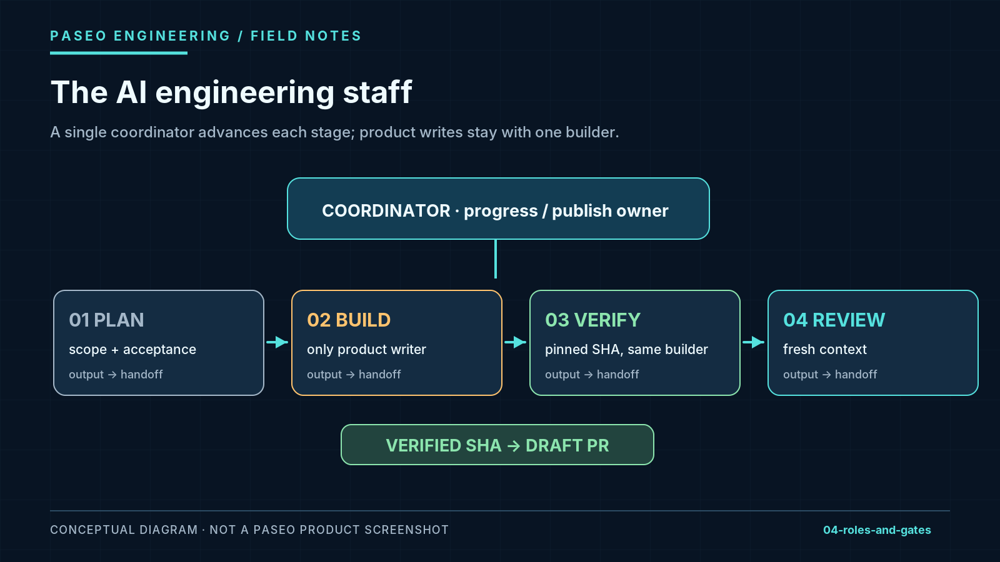
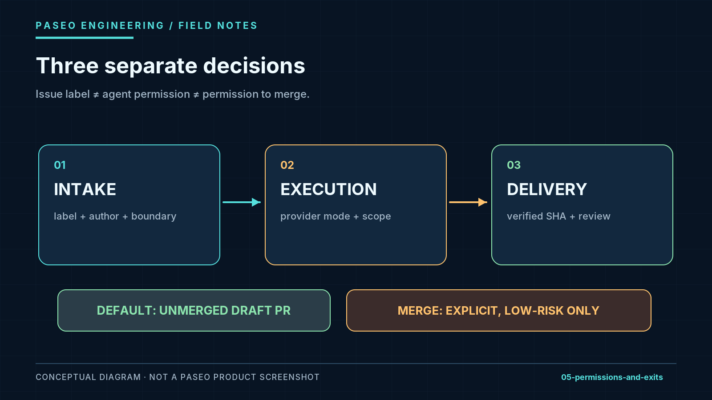

# 我替 Paseo 裝了一位 AI 工程主管：從 GitHub Issue 到 PR 的可安裝 Skill

**副標題：** 一套可以帶到不同 GitHub 專案的 Paseo 工作流程：自動接件、Plan／Build／Verify／Review、失敗接續，以及有條件的 PR 交付。

*這是一篇實作筆記，也是一份讀者可以照著操作的使用指南；不是 Paseo 官方功能公告。*



我想解決一個很具體的問題：**如果我在 GitHub 開好一張 Issue，可不可以讓 Paseo 裡的 Coding Agent 把它接下來，自己完成規劃、寫程式、跑測試、接受另一個 Agent 的審查，最後交回一個我能審閱的 PR？**

我不是要另一個「幫我寫 code」的聊天機器人。我要的是一位**懂得交接、知道何時停下來，而且不會因為一次 timeout 就開兩份 PR 的 AI 工程主管**。

最近我沿著四輪 Pull Request，把這件事拆成了可以重複安裝的 Skill。它以 **Paseo** 為執行環境，以 **GitHub Issue** 為任務入口，以 **Draft PR** 為公開版預設出口。最重要的是：**讀者不必複製我的原始業務專案，也能拿到這套流程的設定、角色指令、進度規則與可選接件器。**

不過先說清楚：**Skill 已可安裝、文件和離線測試可使用；可選的前景接件工具是離線測試過的公開版原型，尚未在你的 Paseo 主機上做端到端實測。** 安裝 Skill ≠ 立刻啟用 unattended AI，更不等於直接自動合併。

## 一、這到底是什麼？先看成品，而不是術語

這個專案是一套面向 Paseo 的 **Issue-to-PR Engineering Skill**。它把一張 Issue 變成有階段、有責任人、有證據的工作，而不是一段聊天。

| 你原本需要親自做的事 | 這套 Skill 替你規範／協調的事 |
| --- | --- |
| 反覆把 Issue 貼給 Agent | 讀取指定 Issue，核對 repo、需求與既有工作 |
| 提醒 Agent 先想再改 | 將 **Plan** 與 **Build** 分開，定義交接文件 |
| 問「你測過了嗎？」 | 對固定 commit SHA 產生 **Verify** 證據 |
| 再開一個聊天找人 Code Review | 交給新 context、不同模型家族的 **Review**（如可用） |
| Agent 卡住後不知道從哪裡接 | 維護 `progress.md`，重新核對 Git／Paseo／GitHub 後接續 |
| 擔心 Agent 直接 merge | 預設停在**未合併的 Draft PR**；升級權限必須另有條件 |

圖示如下。這不是 Paseo 的官方內建畫面，而是此 Skill 的工作模型。



若把它想像成一個小團隊，**Coordinator 是工程主管**：Planner 負責規劃、Builder 負責程式碼、Verifier 在固定版本上檢查、Reviewer 提供第二意見。這些不是四個可以任意互改檔案的機器人；每個角色有不同寫入範圍，而且 **Verify 由原本的 Builder 執行，不一定需要額外開一個 Agent**。

這套設計不會提升模型的 IQ。它改善的是**誰負責、什麼時候能往下走、什麼結果可視為完成**。

## 二、為什麼選 Paseo？ADE 與 Skill 各管一層

Paseo 將自己定位成 **Agentic Development Environment（ADE）**。它不是自己發明一個 Coding Model；它把你已安裝並登入的 Codex、Claude Code、OpenCode 等 Coding Agent 放進一套可管理的開發環境，提供 Project、Workspace、Session、Terminal、Diff 和跨裝置操作等能力。

初次接觸這三個名詞，可以用這個方法理解：

- **Project**：一個程式碼專案，例如一個 Git repository。
- **Workspace**：某張任務的工作空間；可以用獨立 Git worktree／branch 隔離修改。
- **Agent / Session**：在這個 workspace 裡執行具體工作的 AI 對話或執行單元。



Paseo 官方已經支援 Orchestration、Subagents、Skills 與 CLI；**這個專案不是取代它們，而是利用這些能力，補上一套專為 GitHub Issue 交付設計的工作規則**。官方 `/paseo`、`/paseo-handoff`、`/paseo-advisor` 是另一組 Skill；這裡介紹的 `agentic-issue-delivery` 是獨立的自訂 Skill。

*延伸來源：[Paseo 官方介紹](https://paseo.sh/docs/why) · [Worktrees](https://paseo.sh/docs/worktrees) · [Orchestration Skills](https://paseo.sh/docs/skills)*

## 三、讀者可以怎麼開始？先走最簡單的一條路

**最推薦的首次使用方式是「手動指定一張 Issue → 讓 Paseo Agent 依 Skill 工作」**。這樣你能先確認本機環境、角色分工和結果，而不是一開始就打開自動接件器。

你需要：Paseo 桌面版或 CLI；已安裝／登入的 Coding Agent；一個有寫入權限的 Git repository；若要讀寫 GitHub Issue／PR，再準備已登入的 `gh`。Paseo 本身不會附帶替你登入的 Coding Agent CLI。

先在目標 repository 裡核對：

```bash
node --version
gh auth status
paseo status --json
paseo workspace ls --json
paseo provider ls --json
```

接著，**從 [公開 GitHub Repository](https://github.com/wahengchang/agentic-engineering-skills) 安裝這份 Skill**，在目標 repository 執行：

```bash
npx skills add wahengchang/agentic-engineering-skills \
  --skill agentic-issue-delivery
```

或在下載並解壓專案後，用本地路徑安裝：

```bash
npx skills add ./agentic-engineering-skills \
  --skill agentic-issue-delivery
```

`npx skills add` 負責讓指定 Coding Agent 看得到 Skill；**不是讓 Paseo 在背後自動接單**。安裝時請選擇你實際透過 Paseo 使用的 Agent，並確認該 Agent 的 Skill 目錄與選項。Paseo 與 Coding Agent 應在能讀取同一份專案的主機上。

然後，在 Paseo 裡對你的 Agent 下這個指令（把範例換成自己的 Issue）：

> 使用 `agentic-issue-delivery` 處理 [https://github.com/example-org/demo-app/issues/42](https://github.com/example-org/demo-app/issues/42)。先規劃與核對驗收標準，再實作、驗證固定候選、安排獨立審查；不要部署，不要自動合併，最後交回 Draft PR 與進度／證據路徑。已存在的 workspace、PR 和修改要先核對，不要重建。

**第一次使用的成功標準**不是「AI 回答完成」，而是你能看到：固定候選 SHA、實際跑過的檢查、Reviewer 的 finding／處置、可讀回的 Draft PR，以及能接續的 `progress.md`。缺一項就明確指出缺口。

## 四、想要像「值班主管」一樣自動接 Issue？這是另一個可選層

上面是手動模式。進一步，你可以打開專案附帶的**前景 Issue 接件器**。它在 Terminal 前景運作，預設每 10 分鐘查看新票；沒票時只查 GitHub，不需要叫醒 AI。

它的概念很簡單：

**GitHub Issue → deterministic filtering → Paseo Coordinator → 角色工作流。**

這裡有幾個刻意的限制：只接初始化 boundary 之後的新 Issue；預設只看指定作者與確切的 `paseo` label；同時處理一張票；結果不明不直接重送。關閉 Terminal 或 Ctrl+C 會停止後續接件，但**已交給 Paseo 的工作不會因此自動被取消**。

公開版原型的操作入口如下；命令中的 ID 與 provider 必須在你自己的 Paseo 環境中查到，**不能照抄佔位值執行**。以下指令是在 Skill 安裝到 `.agents/skills/` 的情況下使用：

```bash
# 先在目標 repository 的 .gitignore 加入：
# /.local/agentic-issue/
# /draft_agentic-issue-*/

# 初始化並設定要派工的 Paseo workspace / provider
node .agents/skills/agentic-issue-delivery/scripts/issue-intake.mjs init \
  --workspace <WORKSPACE_ID> \
  --provider <DISCOVERED_PROVIDER/MODEL> \
  --mode auto-review

# 先讀回設定與接件邊界
node .agents/skills/agentic-issue-delivery/scripts/issue-intake.mjs status

# 啟動前景接件；Ctrl+C 停止
node .agents/skills/agentic-issue-delivery/scripts/issue-intake.mjs start --every 10m
```

它不是「安裝完就 24/7 自動寫完整專案」的服務。公開原型仍需你確認 workspace、provider、實際 Paseo CLI 參數，以及遇到 dispatch 回執不明時的人工作業；**它不會自己替你驗證所有遠端結果並解開下一張票**。第一次先用 sandbox repo 與低權限設定測試比較合理。

如果你暫時不想管 daemon，完全可以跳過本節。**Skill 的主價值仍然是把一張票從需求帶到可審查的 PR。**

## 五、四輪 PR，真正教會我的四件事

### 1. 工程流程要有「唯一負責人」

我原本以為多 Agent 的關鍵是多開幾個 Session。後來發現，問題更常出在誰都能改、誰都能派工、誰都能宣布完成。

所以我讓 Coordinator 成為唯一的 `progress` 與發布 owner，Builder 成為唯一的產品程式寫入者，Reviewer 只能寫審查報告。這不是降低 AI 能力，而是降低衝突。



### 2. 「沒收到回覆」不等於「沒成功」

假設 `paseo run` 其實建立了 Agent，但網路剛好斷線。直接 retry 可能再造一個 Agent，甚至第二個 PR。

因此流程先記錄 **intent（準備做什麼）**，再確認 **receipt（實際發生什麼）**；如果中間不明，先到 Paseo／GitHub 查原資源，再決定是否重送。這個原則對 Agent 自動化尤其重要：**Reconcile before retry.**

### 3. 測試結果必須綁定「哪個版本」

`Tests passed` 不是結論。要知道通過的 commit SHA、工作樹狀態、實際執行的命令與環境。候選更新後，就要重新判定舊證據是否失效；不能拿上一版的綠燈合併下一版。

所以 Verify 是獨立的一道關卡，Reviewer 也必須直接看 Issue、diff 與測試證據，而不只是信 Builder 的自述。

### 4. 「可用」和「已經在所有環境驗證」不同

把一個資料夾複製到新 repo，常常會發現它還依賴舊專案的 npm script、隱藏設定或別的文件。這也是為什麼我後來將 `SKILL.md`、動作指令、參考文件、接件工具、測試與手冊一起封裝。

但可攜性測試不能代替真實運行：原始迭代曾有特定整合測試失敗；這份公開版的可選接件工具目前只完成離線測試。**我不會把可安裝說成已經無人值守驗收成功。**

## 六、為什麼最終交回 Draft PR，而不是直接 Merge？

因為「能執行」和「應該執行」是兩件事。Agent 也許能用高權限模式直接改檔、跑命令，但 Prompt 裡規定的角色界線**不是 OS sandbox**。`paseo` label 表示接件意向，不能被誤讀成合併許可。

因此公開版預設：完成規劃、實作、固定版本驗證、獨立審查，然後留下**未合併的 Draft PR**。只有另有明確授權、確認低風險、沒有阻斷 finding、base/head 正確且 repository protection 允許時，才考慮合併。



這和 Paseo 的定位並不衝突。Paseo 可以讓你在桌面／手機看到 Agent 與工作進度；Skill 負責告訴 Agent：**哪些事情即使做得到，也不應在條件不足時逕自完成。**

## 七、如果你也用 Paseo，我會建議這樣試

第一天先不要追求全自動。找一個可回滾、沒有部署風險的 Repo，開一張小型文件或 UI 修正 Issue；安裝 Skill，手動指定 Issue；觀察它是否真的先規劃、完整提交、驗證固定 SHA、給出 Reviewer finding，以及交回 Draft PR。**這是最能看見流程價值的第一個實驗。**

第二步才試前景接件器。用一個測試 Repo，新開一張 boundary 之後、加上 `paseo` label 的票；先核對 scope，再啟動 Terminal。觀察空佇列、接單、Ctrl+C 和恢復。不要一開始就授權高權限模式、自動合併或真實部署。

這不是要把人從工程裡移走。它比較像是替 Paseo 裝上了一位**不會忘記驗收標準、懂得交接、願意說「目前不能算完成」的工程主管**。

Coding Agent 負責寫，Paseo 負責讓它們在正確的地方工作；這套 Skill 負責定義**怎麼合作、怎麼證明成果、何時可以交付**。

**你不一定需要更多 Agent。你可能更需要一套可以拿來用的工程流程。**

---

**讀者資源**

- **Skill 專案**：[wahengchang/agentic-engineering-skills](https://github.com/wahengchang/agentic-engineering-skills)
- [Paseo Getting Started](https://paseo.sh/docs)
- [Paseo Workspaces / Worktrees](https://paseo.sh/docs/worktrees)
- [Paseo Orchestration Skills](https://paseo.sh/docs/skills)
- [Paseo CLI Reference](https://paseo.sh/docs/cli)
- [Agent Skills CLI: `npx skills add`](https://github.com/vercel-labs/skills/blob/main/docs/commands.md)

*本文圖片為概念示意，不是 Paseo 應用程式截圖。文章使用去識別化示例，未公開原專案 Issue 內容、個人帳號、Paseo host、實際 session ID 或運行 log。*
