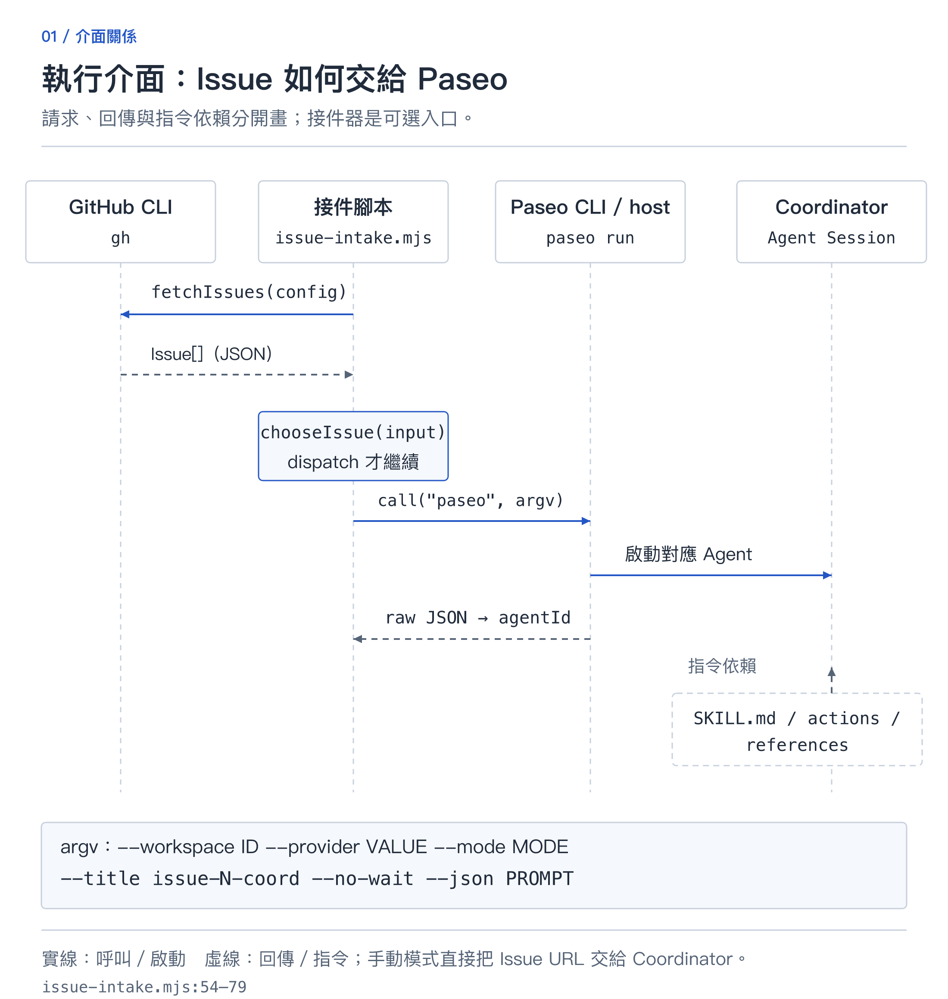
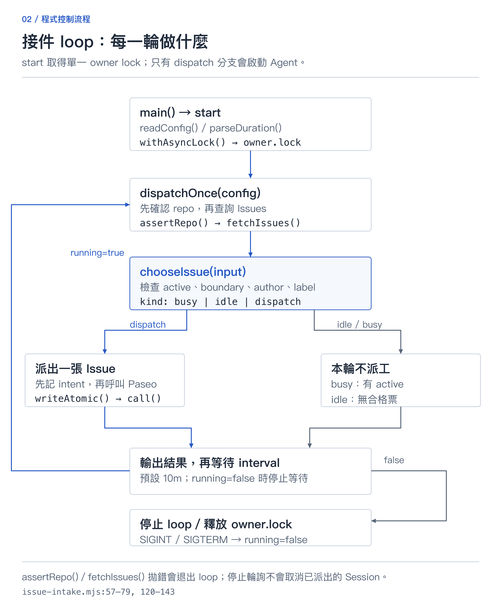
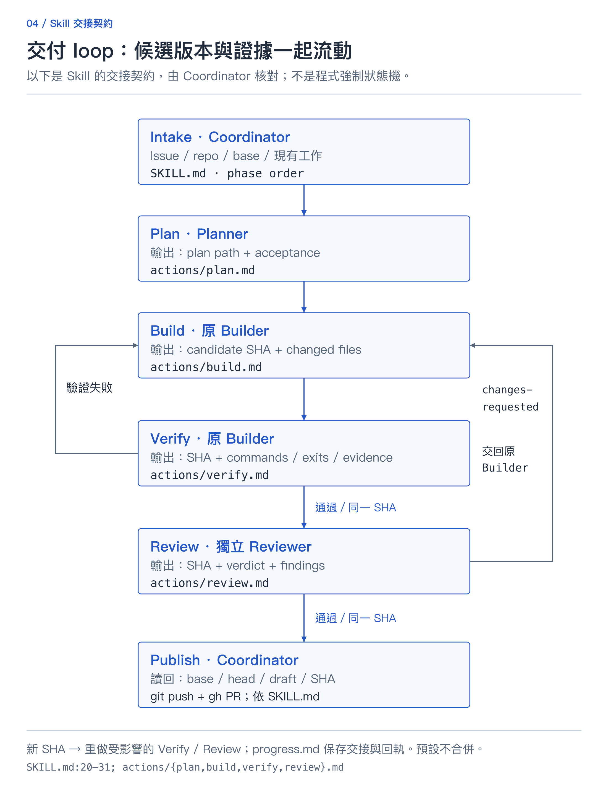
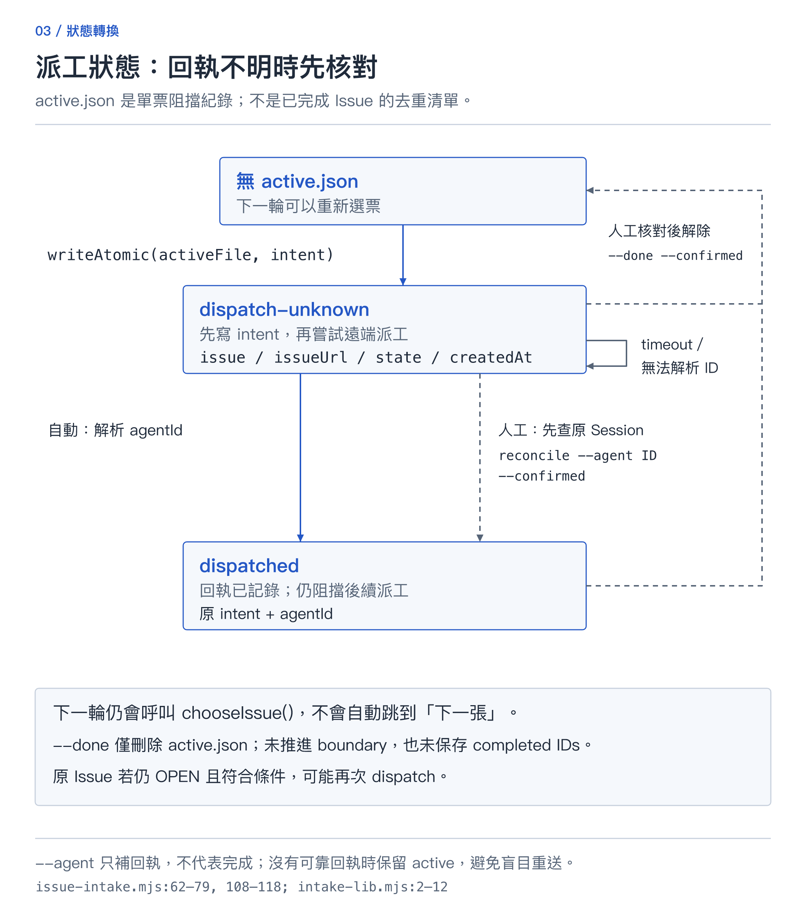

# 從 ADE 到 Issue → PR：Paseo 工程工作流程的架構與實作

一套安裝到 Coding Agent 的工程流程：從執行環境、元件分工，到固定版本驗證與 Draft PR 交付。

## 一、什麼是 ADE？

**ADE 是 Agentic Development Environment，讓 Coding Agent 執行開發任務的工作環境。** 以修正登入頁面為例：開發者提出需求，Agent 讀取程式碼、修改檔案、透過 Terminal 跑測試，再由開發者查看 Diff 和執行結果。這些工作需要檔案、Git、執行工具與可持續追蹤的對話。

[Paseo](https://paseo.sh/docs/why) 是這類環境的一個實作。它整合 Agent 對話、編輯器、Terminal、Diff 與桌面瀏覽器，也能管理多個任務的工作空間。

在這個工作方式中，開發者仍然決定任務範圍、檢查結果與是否接受修改；Agent 則在可用的工具與權限內執行。ADE 把這些操作放在同一個可管理的環境，讓人能找到任務的程式碼、對話和測試結果。

先區分三個概念：**Project** 對應專案；**Workspace** 是任務的工作空間，可使用獨立 branch／worktree 隔離修改；**Agent Session** 是在該空間中執行工作的 Agent 對話。多個 Session 可以在同一個 Workspace 協作，但需要約定誰能修改哪些檔案。

Paseo 透過 **provider** 接入已安裝、已登入的 Coding Agent CLI，例如 Codex 或 Claude Code。Provider 定義啟動、輸入、輸出與執行模式的介面；實際 CLI 在執行主機上運作。模型推論是否使用雲端服務，則取決於 provider 的設定。[Provider 文件](https://paseo.sh/docs/providers)

## 二、這個專案加了什麼？

[agentic-engineering-skills](https://github.com/wahengchang/agentic-engineering-skills) 提供一個名為 `agentic-issue-delivery` 的 Skill，目標是讓指定的 GitHub Issue 經過規劃、實作、驗證與審查，交回可供人工檢查的 Draft PR。

專案內容分成三部分：

- **`SKILL.md`**：定義 Coordinator 的工作順序、完成條件、角色分工與失敗接續規則。
- **`actions/` 與 `references/`**：提供各階段指令、交接格式、進度紀錄與權限判斷依據。
- **`scripts/issue-intake.mjs`**：可選的 Node 接件腳本，查詢 GitHub Issue，將符合條件的工作派給 Paseo。

例如，一張要求修改表單提示文字的 Issue，除了程式碼 diff，還需要能對照原需求的驗收條件、候選版本與審查結果。Skill 將這些要求寫成可重複使用的指令，讓每次處理任務時都有相同的交接依據。

前兩部分是讓 Agent 讀取的指令文件。它們要求 Agent 遵循流程，並沒有實作一個強制控制每次轉換的工作流引擎。角色的寫入界線仍須搭配執行工具的權限與 repository protection。

如果專案有自己的規劃、建置或驗證步驟，可以提供對應階段的 action 覆寫文件。文件必須包含執行前核對、工作指令與交付項目，讓 Coordinator 知道交接條件；缺少必要段落時要停止處理，不能略過。專案設定也不能取消固定版本驗證或獨立審查的完成要求。

接件腳本則有具體的判斷與狀態檔。安裝 Skill 只讓 Coding Agent 看得到這些內容；不會啟動接件、建立排程或授予合併權限。

## 三、系統的大架構

這裡先看元件如何連接，再看階段怎麼推進。Workspace 決定工作在哪裡執行；角色決定各個 Session 負責什麼；進度文件讓下一次接續時有可核對的紀錄。建立多個 Session 本身，不會自動得到這些分工。

任務有兩種入口，最後都交給 Coordinator：

**手動入口**是直接把 Issue URL 交給 Paseo 裡的 Agent，要求使用這個 Skill。首次使用走這條路，就能先核對需求、工作空間與交付結果。

**可選自動入口**是由前景接件腳本透過 `gh` 查詢 Issue。它只挑選編號大於初始化 boundary、指定作者建立、帶有確切 `paseo` label 的開放 Issue。沒有符合條件的票，就不派出新 Agent；有未解除的 `active.json`，則暫停後續派工。

腳本使用預先設定的 Workspace 與 provider 呼叫 `paseo run`。它不會替每張 Issue 自動建立隔離空間，因此必須先確認 Workspace 對應正確的 repository。



*介面圖：接件器透過 CLI 派工；Paseo 回傳的是 Session 回執，工程完成與否需另外核對。*

核心呼叫順序是 `dispatchOnce(config)` 先以 `assertRepo()` 核對環境，再用 `fetchIssues()` 取得資料，交給純函數 `chooseIssue({issues, boundary, author, active})`。它回傳 `busy`、`idle` 或 `dispatch`；只有最後一種會執行 `call("paseo", argv)`。派工前先以 `writeAtomic()` 保存意圖。



*輪詢圖：`main()` 的 start 分支以 `withAsyncLock()` 取得 owner.lock，再執行輪詢。busy 也會先查 GitHub；環境核對或查詢出錯會退出 loop。*

**Coordinator** 是目前負責整張 Issue 的 Agent：讀取 Skill、派工、收集證據、維護 `progress.md`，最後透過 Git 推送候選，再使用 `gh` 建立或重用 Draft PR。Planner 負責計畫；Builder 負責產品程式與驗證；Reviewer 負責獨立審查，只寫審查報告。

GitHub 保存需求與 PR；Paseo 管理執行中的 Agent 與 Workspace；Skill 定義工作規則。本專案的接件器是自訂原型。Paseo 官方另有 [Hub](https://paseo.sh/docs/hub) 處理外部事件觸發，不屬於這個腳本的實作。

## 四、一張 Issue 如何變成 Draft PR？

以下是 Skill 要求的處理順序，由 Coordinator 核對各階段產出後繼續。每次交接都要帶上原需求、工作範圍、使用的 Workspace，以及預期報告位置；涉及候選時還要附上 SHA。接手的角色先確認檔案可讀，再開始工作。

**1. Intake：確認要做的事。** Coordinator 讀取 Issue、採納的留言與專案指令，核對 repository、base branch、權限及現有 Workspace／PR。需求或權限不清楚時先記錄阻礙，不建立重複工作。

**2. Plan：產生可驗收的計畫。** Planner 根據需求與現有程式碼，寫出修改範圍、設計、驗收標準與測試方式；此階段不修改產品程式。計畫仍有未決事項時，回到需求釐清。

**3. Build：實作並提交候選。** Builder 依計畫修改、補上必要測試，提交包含新增檔案的完整變更。產出為候選 commit SHA、變更摘要與證據路徑；尚未完成時不進入交付。

Build 與 Verify 是兩個階段，但由同一個 Builder 執行，方便保留修改脈絡。Reviewer 則使用新的 context，直接檢查候選與證據。文章中的角色是責任分工，不代表必須同時開四個 Agent，或為每一步建立新的 Session。

**4. Verify：驗證固定版本。** 原 Builder 對固定 SHA 執行專案要求的檢查，記錄命令、環境、退出碼與結果。若失敗，回到 Build；若驗證中改了程式，就必須重新固定候選與驗證。

**5. Review：獨立檢查候選。** Reviewer 使用新的 context，讀取原需求、計畫、實際 diff 與測試證據；可用時選不同模型家族。發現問題後交回原 Builder 修正，再重新 Verify 與 Review。

**6. Publish：讀回交付結果。** Coordinator 確認驗收通過、阻斷問題已處理，推送已驗證的 SHA，建立或重用 Draft PR，再讀回 base、head、draft 狀態與 SHA。預設到此結束，留下未合併的 PR。



*交付圖：每一步交回 SHA、文件或證據；修正後須重新驗證、審查。這是 Skill 交接契約，沒有獨立的 `verify()`／`review()` 工作流引擎。*

## 五、進度與失敗怎麼處理？

這裡有兩份用途不同的紀錄。判斷是否能接續時，要把紀錄與外部實況一起看：文件寫了「已建立 PR」，就讀回該 PR；寫了「驗證通過」，就檢查它對應的 SHA。只有階段名稱，無法判斷工作是否真的完成。

**`progress.md` 保存工程工作的進度。** 由 Coordinator 維護，放在穩定 checkout 下、被 Git 忽略的 draft 目錄，記錄需求、階段、Session、候選 SHA、驗證與審查證據，以及 PR 回執。重新開啟對話時，先讀這份紀錄，再核對 Git、Paseo 與 GitHub 的實際狀態。

計畫與證據保留在穩定的 draft 目錄，而不是只留在臨時 worktree 或聊天內容中。這樣即使原對話中斷，仍能找回原始需求、已做的修改與下一步；重新開對話前也應先確認原 Session 是否仍在執行。

例如 Reviewer 發現新增的輸入驗證漏了一個邊界條件：Coordinator 記錄 finding，交回原 Builder。修正產生新 SHA 後，舊測試結果不能直接當作新候選的通過證據，必須重新驗證並交給 Reviewer 複查。

**`active.json` 保存接件器目前派出的票。** 它在派工前先寫入意圖；若成功取得 Session ID，再更新紀錄。假設 `paseo run` timeout，遠端 Agent 可能已建立，紀錄會保留為 `dispatch-unknown`。此時先到 Paseo 找原 Session，核對結果後再 reconcile，避免直接重送。

接件器不會自動判斷 PR 已完成。必須由人核對目前票的結果，再使用 `cmdReconcile()` 對應的 `reconcile --issue N --confirmed` 命令：`--agent ID` 只補回執；`--done` 才刪除 active 紀錄。Ctrl+C 停止的是後續輪詢，已派到 Paseo 的 Session 仍可能繼續執行。



*恢復圖：回執不明先找原 Session；人工解除 active 只影響接件器，沒有自動完成通知。*

這裡有一個原型限制：`--done` 不會推進 boundary 或記錄 completed Issue。下一輪仍重新選票；原票若仍開放且符合條件，可能再次被選到。不能把清除 active 描述成「保證接下一張」。`progress.md` 與 `active.json` 之間也沒有自動同步介面。

## 六、怎麼開始與目前限制

第一次試跑可選擇一張範圍小、容易人工比對的文件修正 Issue。先看計畫是否對應需求，再核對實際 diff 和 PR head SHA；如果 Agent 只回覆「完成」，但沒有交付證據，就把缺少的項目列為未完成。

先準備可用的 Paseo、已登入的 Coding Agent，以及對目標 repository 有適當權限的 `gh`。在目標專案中安裝：

```bash
npx skills add wahengchang/agentic-engineering-skills \
  --skill agentic-issue-delivery
```

選擇你在 Paseo 中實際使用的 Agent，再手動指定一張小型 Issue：

> 使用 `agentic-issue-delivery` 處理這張 Issue：
> https://github.com/example-org/demo-app/issues/42
> 核對需求與現有工作後，依 Plan、Build、Verify、Review 執行。不要部署或合併；最後交回 Draft PR、候選 SHA，以及進度和驗證證據的位置。

上面的 Issue URL 是示例，請換成自己的票。先檢查實際 diff、驗證結果與審查報告，再決定下一步。接件器的初始化、Git 忽略設定與恢復命令，見 [操作文件](https://github.com/wahengchang/agentic-engineering-skills/blob/main/skills/agentic-issue-delivery/scripts/README.md)。

如果之後要開啟自動接件，先依操作文件設定 Git 忽略路徑，核對指定作者、初始化邊界、Workspace 與 provider，再用測試 repository 觀察派工與人工解除 active 紀錄的行為。接件頻率與執行權限應在確認環境後設定。

目前九項測試涵蓋離線的篩選、單票阻擋、時間間隔與權限模式判斷。公開版接件器尚未完成真實 Paseo → GitHub 的端到端驗收，CLI 參數與回應格式也需對照安裝版本確認。安裝成功後，仍需在自己的環境驗證整個工作流程。

函數的輸入／回傳形狀、完整 CLI 參數與各階段交接介面，見 [介面與 loop 說明](engineering-interfaces.zh-TW.md)。
